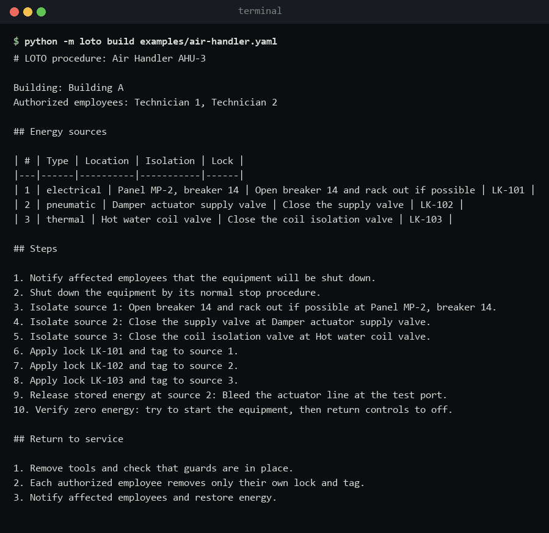

# lockout-tagout-procedure-builder

Turns a YAML description of equipment and its energy sources into a validated Markdown lockout tagout procedure sheet.



## What it is for

Lockout tagout (LOTO) procedure sheets are usually typed by hand in a word processor, and steps get missed: a lock number reused on two sources, or stored energy never released. A safety officer or maintenance supervisor describes each machine once in YAML. The tool validates it and prints the same procedure layout every time, so technicians see a consistent sheet for every air handler, pump or boiler.

## Install

```
git clone <repo-url> lockout-tagout-procedure-builder
cd lockout-tagout-procedure-builder
pip install -e .
```

Python 3.10 or newer. PyYAML is installed with the package.

## How to use

| I want to | Command |
|---|---|
| Print a procedure sheet | `python -m loto build examples/air-handler.yaml` |
| Write the sheet to a Markdown file | `python -m loto build examples/air-handler.yaml --out sheet.md` |
| See the help for the build command | `python -m loto build --help` |
| Run the tests | `python -m pytest -q` |

Worked example:

```
python -m loto build examples/air-handler.yaml
```

```
# LOTO procedure: Air Handler AHU-3

Building: Building A
Authorized employees: Technician 1, Technician 2

## Energy sources

| # | Type | Location | Isolation | Lock |
|---|------|----------|-----------|------|
| 1 | electrical | Panel MP-2, breaker 14 | Open breaker 14 and rack out if possible | LK-101 |
| 2 | pneumatic | Damper actuator supply valve | Close the supply valve | LK-102 |
| 3 | thermal | Hot water coil valve | Close the coil isolation valve | LK-103 |

## Steps

1. Notify affected employees that the equipment will be shut down.
2. Shut down the equipment by its normal stop procedure.
3. Isolate source 1: Open breaker 14 and rack out if possible at Panel MP-2, breaker 14.
4. Isolate source 2: Close the supply valve at Damper actuator supply valve.
5. Isolate source 3: Close the coil isolation valve at Hot water coil valve.
6. Apply lock LK-101 and tag to source 1.
7. Apply lock LK-102 and tag to source 2.
8. Apply lock LK-103 and tag to source 3.
9. Release stored energy at source 2: Bleed the actuator line at the test port.
10. Verify zero energy: try to start the equipment, then return controls to off.

## Return to service

1. Remove tools and check that guards are in place.
2. Each authorized employee removes only their own lock and tag.
3. Notify affected employees and restore energy.
```

## How it works

- The YAML lists the equipment, building, authorized employees and each energy source with type, location, isolation method and lock id.
- Validation reports every problem at once: missing fields, unknown energy types, a lock id used twice.
- Hydraulic, pneumatic, gravity and stored sources must have a `release` step.
- The sheet lists sources in a table, then steps in a fixed order: notify, shut down, isolate, lock and tag, release stored energy, verify zero energy.
- A return to service section follows. Use `--out sheet.md` to write a file.

## Limits

The step order is a general template. It is not a substitute for a procedure reviewed by your safety officer, and it does not cover group lockout or contractor handover. Needs PyYAML.

## License

MIT. Copyright 2026 Yassine Emhamed.
